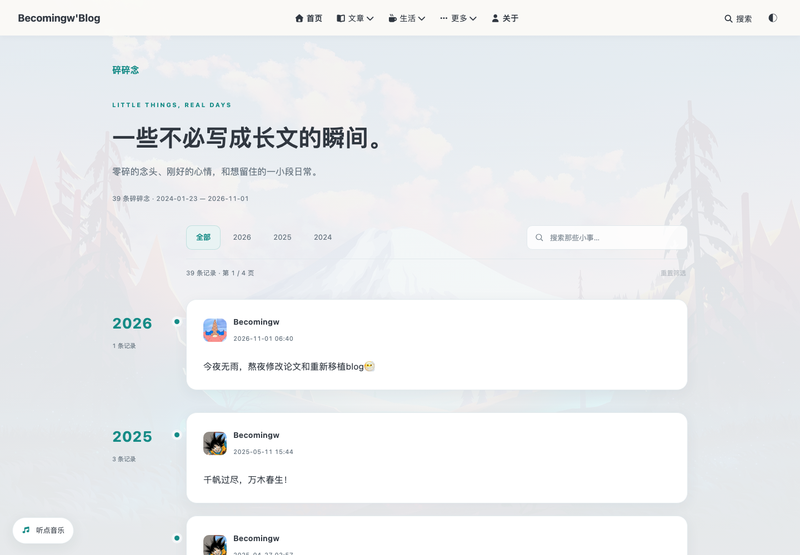
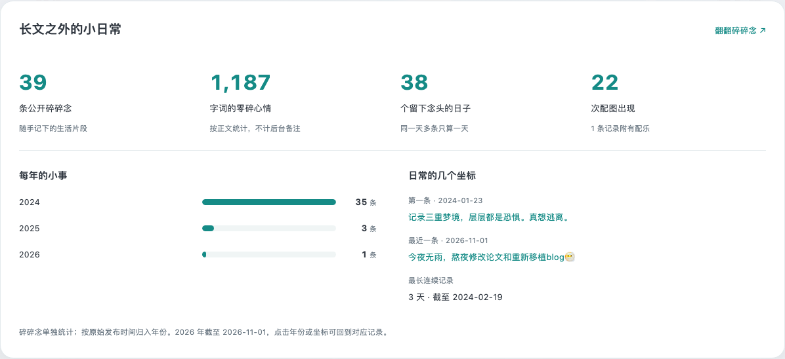
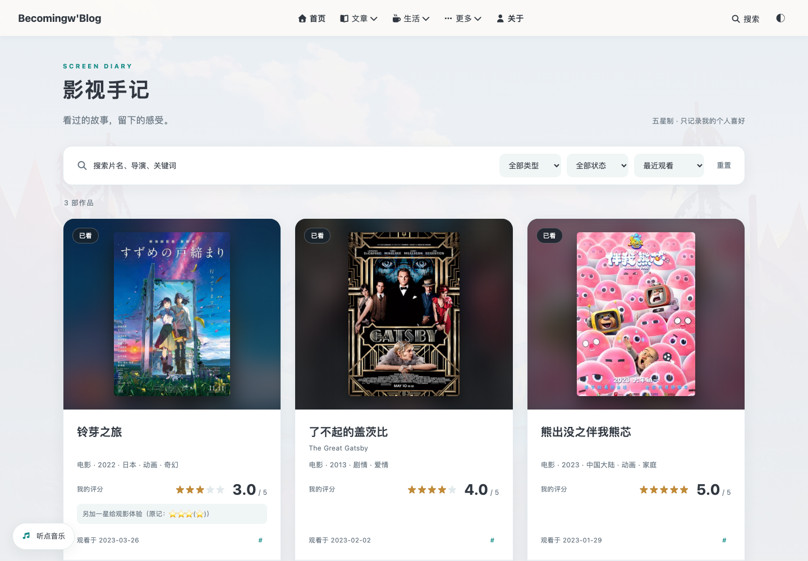
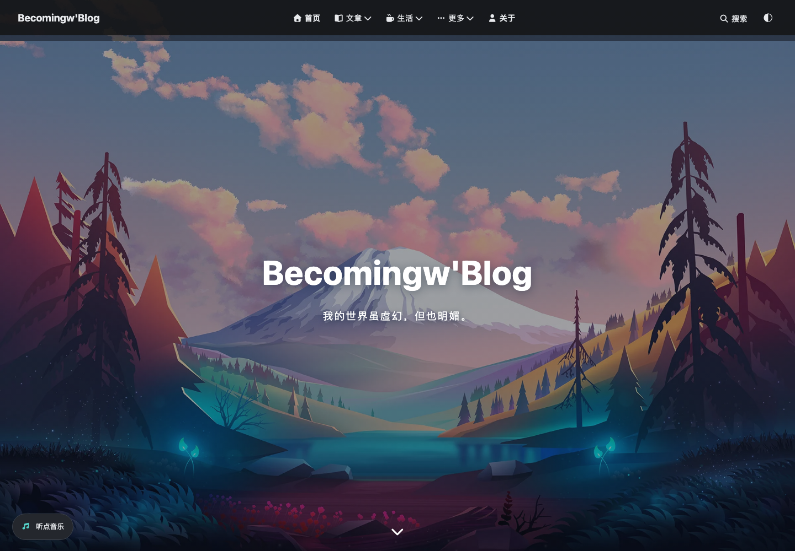

# Butterfly Scenic Journal · 山间手记

一个以生活与阅读为中心的 **Hexo + Butterfly 整站模板**：安静的山景首页、海报式影视手记、轻量碎碎念、可探索的文章历程，以及顺手的后台编辑。

[](https://github.com/Becomingw/butterfly-scenic-journal/actions/workflows/check.yml)
[](LICENSE)

[在线示例：Becomingw Blog](https://hexo.scosine.org/) · [碎碎念](https://hexo.scosine.org/moments/) · [文章历程](https://hexo.scosine.org/journey/)


> 展示配图直接取自 Becomingw Blog。模板使用同款山景背景，并附两篇示例文章、一条虚构影评和三条示例碎碎念；截图中的实际内容与统计属于演示站。

## 有什么？

- **山景首页**：大幅插画、图片优先卡片、侧栏作者面板；响应式与深浅色。
- **碎碎念**：按年时间线、轻量搜索与年份点选、分页、图片灯箱、固定链接、可选配乐；支持纯文字或纯图片，后台可独立管理。
- **文章历程**：年度篇数/字词切换、文章/碎碎念双模式发布日历、标签与分类分布、长短文、星期节奏、连续发布、里程碑。新增碎碎念数量、字词、配图、活跃日期和年度分布，附统计口径。
- **影视手记**：Markdown 数据、海报、半星评分、筛选排序、原生折叠长评；Decap 后台表单与预览。
- **文章探索**：关键词、分类、年份、排序、分页、随机阅读；本地全文搜索。
- **阅读体验**：字号、复制链接、专注阅读、进度条、打印、PJAX。
- **音乐列表**：可配置 JSON 歌单或兼容 API，主动点击播放；站内切页保留播放器。
- **项目页**：GitHub 公开非 Fork 仓库前十，分页抓取、Star 优先、失败保留快照。
- **双语关于页**、RSS、sitemap、代码块、可选数学与 Mermaid。
- **登录后编辑**：Decap 提供文章、影视手记、碎碎念集合；文章支持独立封面与预览，写入权限由仓库控制。

这是可以直接写作的 starter，而不是仅放入 `themes/` 的独立 Hexo 主题包。上游 Butterfly 由 npm 安装，自定义层不修改其源文件。

### 页面预览

| 碎碎念 | 碎碎念历程统计 |
| --- | --- |
|  |  |
| 影视手记 | 深色模式 |
|  |  |

[完整发布日历](docs/screenshots/journey.png) · [手机界面](docs/screenshots/mobile.png) · [配图来源](docs/ASSETS.md)

## 5 分钟开始

点击 GitHub **Use this template** 创建自己的仓库，或：

```sh
git clone https://github.com/Becomingw/butterfly-scenic-journal.git my-blog
cd my-blog
nvm install
nvm use
npm ci
npm run build
npm run check
npm run server
```

打开 <http://localhost:4000>。默认两篇文章、一条虚构影评、三条示例碎碎念；不需要 API 密钥或 CMS 登录就能构建。音乐与 GitHub 项目初始为空，页面显示配置提示。

### 先改这些

| 文件 | 内容 |
| --- | --- |
| `_config.yml` | 标题、作者、网址、时区 |
| `_config.butterfly.yml` | 导航、头像、社交链接、主题色、文章版权 |
| `journal.config.json` | GitHub 用户名、音乐歌单 URL |
| `source/me/index.md` | 中英文个人介绍 |
| `source/_posts/*.md` | 文章 |
| `content/media/*.md` | 影视手记 |
| `content/moments/*.md` | 碎碎念，ISO 日期须带时区 |
| `source/admin/config.yml` | 可选 Gitea/Decap 后台配置 |

目前要求 **域名根路径部署**，如 `https://blog.example.com/`。不要直接部署到 GitHub Pages 的 `/repository/` 子路径；使用自定义域名或 `username.github.io` 根站点。

## 详细文档

- [配置、音乐、项目、CMS](docs/CONFIGURATION.md)
- [碎碎念字段与统计](docs/MOMENTS.md)
- [Gitea Actions / 静态部署](docs/DEPLOYMENT.md)
- [冻结版本、回滚、升级](docs/FREEZE.md)
- [功能与验证记录](docs/VERIFICATION.md)
- [许可证与素材来源](NOTICE)
- [更新记录](CHANGELOG.md)

## 版本与冻结基线

**v1.1.0** 同步碎碎念、轻量筛选栏、历程统计、后台封面与登录后管理。构建运行时和依赖沿用 v1.0.0 的固定版本。

**v1.0.0** 固定 Hexo **7.3.0**、Butterfly **5.7.0**、Node **22.23.4** / npm **10.9.9**。所有直接依赖使用精确版本，传递依赖锁在 `package-lock.json`；CI 使用镜像摘要。文章、日期统计与仓库数据可以继续更新。

升级需手动评估并通过检查，不自动跟随 Butterfly 新版。第三方网络服务与音乐可用性不属于冻结保证。

## English

Scenic Journal is a complete Hexo/Butterfly starter for a personal, life-first blog. It includes a scenic homepage, poster-first film diary, a searchable moments timeline, separate article/moment statistics and activity calendars, discovery and local search, a configurable persistent music player, GitHub project snapshots, and optional Decap CMS editing with post-cover previews. It keeps the upstream theme npm-managed and unmodified.

Use Node from `.nvmrc`, run `npm ci && npm run build && npm run check`, then `npm run server`. Configure site identity in `_config.yml` and `_config.butterfly.yml`; integrations in `journal.config.json`. Deploy at the domain root. Screenshots and the mountain background come from [Becomingw Blog](https://hexo.scosine.org/); editable content remains fictional examples. Production OAuth settings, private infrastructure configuration and music tracks are not shipped.

## License

Apache-2.0 for this customization, documentation, fictional example content and original SVG artwork. Blog screenshots and the blog-sourced mountain image are demonstration assets with separate attribution in [NOTICE](NOTICE) and [ASSETS](docs/ASSETS.md). Butterfly is Apache-2.0; bundled APlayer retains its MIT license. This project is independent of the upstream Butterfly project.
